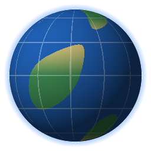
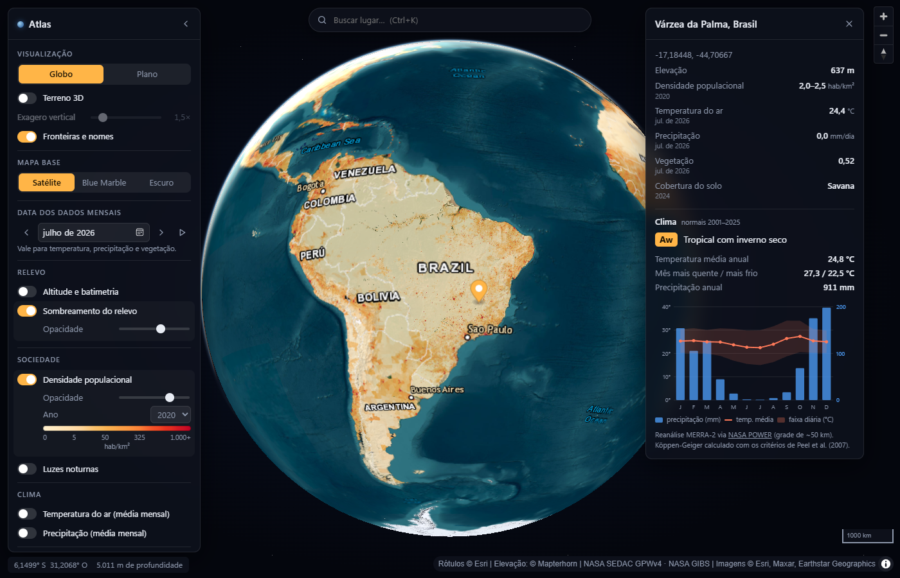
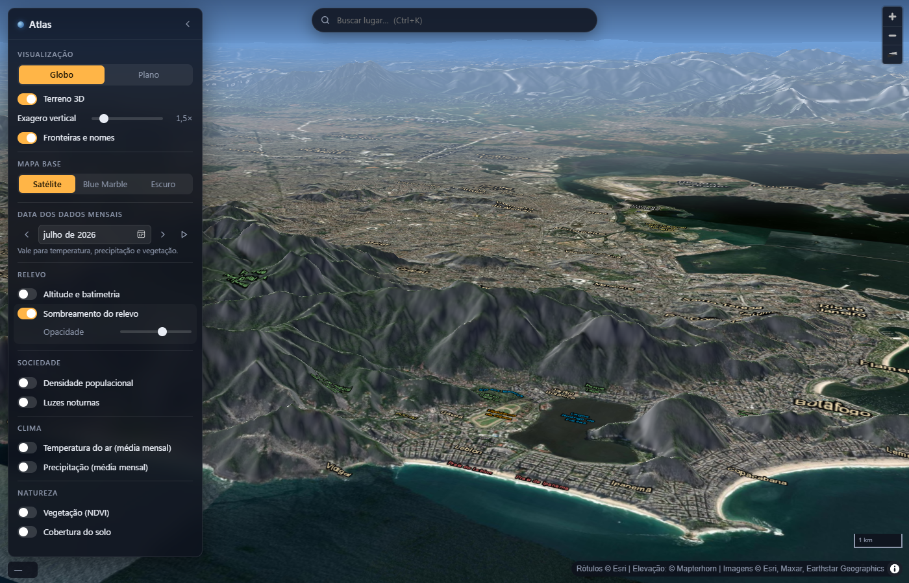
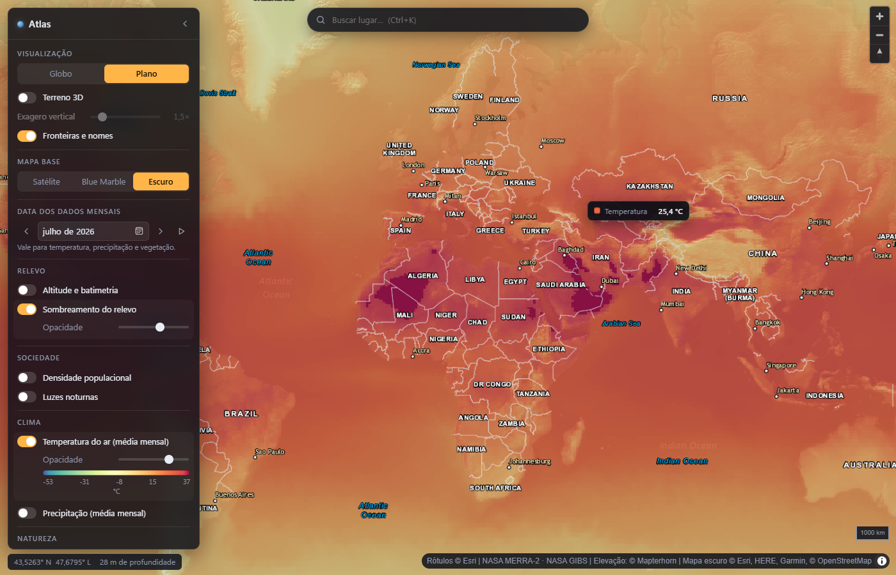

<div align="center">



# Atlas

**Globo interativo para desktop: relevo, população, clima e mais, sobre imagens de satélite, com terreno 3D.**

[](https://github.com/VonElfin/atlas/releases/latest)
[](LICENSE)


[**Baixar para Windows**](https://github.com/VonElfin/atlas/releases/latest) · [Recursos](#recursos) · [Compilar](#compilar-a-partir-do-código) · [Como funciona](#como-funciona) · [Contribuir](CONTRIBUTING.md)



</div>

## Sobre

O Atlas é um explorador de mapas para desktop no estilo do Google Earth, focado em **dados geográficos abertos**. Mostra relevo, densidade populacional, temperatura, precipitação, vegetação, cobertura do solo e luzes noturnas sobre o globo, e informa o valor exato de cada camada em qualquer ponto.

Ele é leve de propósito. Em vez de embutir um navegador inteiro (como o Electron), usa o WebView2 que já vem no Windows e desenha tudo na GPU com WebGL2. O instalador tem cerca de 3 MB, e o app usa ~2% de um núcleo de CPU quando está parado.

Não precisa de conta nem de chave de API: todos os dados vêm de serviços públicos (NASA, Esri, OpenStreetMap, Mapterhorn).

## Recursos

- **Globo 3D ou mapa plano**, com atmosfera, inclinação e rotação livres.
- **Terreno 3D** com exagero vertical ajustável.
- **Camadas temáticas** com legenda e opacidade ajustável:

  | Grupo | Camada | Período |
  |---|---|---|
  | Relevo | Altitude e batimetria, sombreamento | — |
  | Sociedade | Densidade populacional | 2000, 2005, 2010, 2015, 2020 |
  | Sociedade | Luzes noturnas | 2012, 2016 |
  | Clima | Temperatura do ar, precipitação | mensal, de 1980 até hoje |
  | Natureza | Vegetação (NDVI) | mensal, de 2000 até hoje |
  | Natureza | Cobertura do solo | anual, 2001–2024 |

- **Valores, não só cores:** ao passar o mouse, um selo mostra o valor de cada camada ligada (ex.: "Temperatura 22,9 °C").
- **Ficha de qualquer ponto** (clique): nome do lugar, elevação, valor de todas as camadas, **classificação climática de Köppen-Geiger** e climograma com as médias mensais.
- **Linha do tempo** para as camadas mensais, com animação mês a mês.
- **Busca de lugares** (Ctrl+K).
- **Mapas base:** satélite, Blue Marble (NASA) e escuro.
- Lembra as camadas, o mapa base e a posição da câmera entre sessões.

<table>
  <tr>
    <td></td>
    <td></td>
  </tr>
  <tr>
    <td align="center">Terreno 3D (Rio de Janeiro)</td>
    <td align="center">Temperatura média de julho, com o selo de valor</td>
  </tr>
</table>

## Instalação

1. Baixe `Atlas-Setup-<versão>.exe` na [página de releases](https://github.com/VonElfin/atlas/releases/latest).
2. Execute. A instalação é por usuário, não pede administrador e cria um atalho no menu Iniciar.
3. Para desinstalar: **Configurações → Aplicativos → Atlas → Desinstalar**.

> [!NOTE]
> O instalador ainda não é assinado digitalmente, então o Windows SmartScreen pode mostrar "O Windows protegeu o computador". Clique em **Mais informações → Executar assim mesmo**. O instalador é gerado pelo [workflow público](.github/workflows/release.yml) a partir deste código.

**Requisitos:** Windows 10 ou 11 (64 bits) e conexão com a internet. O app usa o Microsoft WebView2, que já vem no Windows 11 e no Windows 10 atualizado; se faltar, o instalador o baixa da Microsoft.

## Uso

| Ação | Como |
|---|---|
| Girar / mover | arrastar |
| Inclinar e rotacionar | botão direito + arrastar, ou Ctrl + arrastar |
| Zoom | roda do mouse |
| Ficha de um ponto | clique |
| Buscar lugar | Ctrl+K, digite e Enter |
| Fechar painéis | Esc |

## Compilar a partir do código

Pré-requisitos: [Node.js](https://nodejs.org) 20 ou mais recente e Windows (para gerar o instalador).

```bash
git clone https://github.com/VonElfin/atlas.git
cd atlas
npm install
npm run setup        # baixa os binários do Neutralinojs (bin/ e resources/js/neutralino.js)
npm start            # abre o app em modo de desenvolvimento
```

| Comando | O que faz |
|---|---|
| `npm start` | Abre o app lendo `resources/` direto do disco |
| `npm run dev` | Igual, com DevTools (F12) |
| `npm run build` | Gera os executáveis em `dist/atlas/` (Windows, Linux e macOS) |
| `npm run installer` | Build + instalador `release/Atlas-Setup-<versão>.exe` (Inno Setup; só no Windows) |
| `npm run catalog` | Atualiza o catálogo de camadas da NASA (datas disponíveis e paletas) |
| `npm run icon` | Regenera os ícones |

O executável também é gerado para Linux e macOS, mas só a versão Windows é testada e distribuída.

## Como funciona

**Stack.** [Neutralinojs](https://neutralino.js.org) cria a janela nativa sobre o WebView2 do sistema e [MapLibre GL JS](https://maplibre.org) desenha o mapa em WebGL2. A interface é HTML, CSS e JavaScript, sem framework nem etapa de build.

**Valor de um pixel.** As camadas da NASA são imagens coloridas, não dados numéricos. O app baixa o mesmo tile que está na tela, lê a cor do pixel sob o cursor e a converte de volta em valor pela paleta que a NASA publica (por exemplo, `rgb(240,59,32)` vira "250–500 hab/km²"). A elevação vem de tiles em que a altitude está codificada nos canais RGB.

**Clima de um ponto.** A ficha consulta a climatologia mensal da NASA POWER (12 valores, ~1,5 KB) e calcula a classificação de Köppen-Geiger com os critérios de Peel et al. (2007). Num teste com 27 cidades de referência, 25 bateram com a classificação publicada; as outras duas divergem por causa da grade de ~50 km.

**Carregamento.**
- Quando o mapa para, o app baixa em segundo plano os tiles ao redor da tela e dos níveis de zoom vizinhos. Qualquer movimento cancela.
- Servidores que às vezes travam (Esri, S3) passam por um fetch com timeout de 5 s e *pedido de reserva*: sem resposta em 1,2 s, o mesmo tile é pedido também no host espelho.
- O NASA GIBS proíbe cache (`no-store`), então o app guarda esses tiles em memória durante a sessão.
- Tiles já baixados saem do cache em disco sem consultar o servidor.

**Desempenho medido** no app nativo (Windows 11, GPU dedicada, janela de 1400×900):

| Cenário | Resultado |
|---|---|
| Globo e mapa plano (pan, zoom, voos) | 65–160 fps |
| Terreno 3D inclinado | 35–67 fps |
| Clique até a ficha com clima | ~0,4 s |
| CPU com o app parado | ~2% de um núcleo |
| Memória | ~370 MB ao abrir; ~1,3 GB após uso pesado (inclui GPU) |

### Estrutura

```
resources/
  index.html, css/app.css   interface
  js/main.js                mapa, painel, linha do tempo, ficha do ponto, busca
  js/layers.js              catálogo de mapas base e camadas (comece por aqui)
  js/tiles.js               fetch robusto, caches, fallback de tiles ausentes
  js/prefetch.js            pré-carregamento ao redor da tela
  js/probe.js               leitura de valores por pixel
  js/climate.js             normais climáticas, Köppen-Geiger, climograma
  js/legend.js              legendas
  data/gibs-catalog.json    gerado por scripts/build-catalog.mjs
  vendor/maplibre/          MapLibre GL JS 6.15
scripts/                    catálogo, ícones, instalador
installer/                  script do Inno Setup, ícone, avisos de terceiros
docs/                       imagens do README
neutralino.config.json      janela, permissões nativas, versão
```

### Adicionar uma camada

1. Ache o id da camada no [GetCapabilities do NASA GIBS](https://gibs.earthdata.nasa.gov/wmts/epsg3857/best/1.0.0/WMTSCapabilities.xml) e inclua em `LAYERS`, em [scripts/build-catalog.mjs](scripts/build-catalog.mjs).
2. Rode `npm run catalog`.
3. Adicione uma entrada em `OVERLAYS`, em [resources/js/layers.js](resources/js/layers.js), com `format` e `unit` para o valor aparecer no selo e na ficha.

Mais detalhes em [CONTRIBUTING.md](CONTRIBUTING.md).

## Limitações conhecidas

- **Só Windows** é testado e distribuído.
- **Precisa de internet:** não há modo offline.
- **Resolução dos dados:** temperatura e precipitação têm células de ~50 km, e a densidade populacional, de ~1 km. De perto, essas camadas aparecem em blocos.
- **Servidor público do Esri:** às vezes fica lento por alguns segundos. Enquanto isso o app mostra a versão menos detalhada do tile.
- **Mapa plano:** usa Web Mercator, que distorce as áreas perto dos polos.

## Fontes de dados

| Dado | Fonte | Termos |
|---|---|---|
| Imagens de satélite, rótulos, mapa escuro | [Esri](https://www.esri.com), Maxar, Earthstar Geographics, HERE, Garmin | [Termos da Esri](https://www.esri.com/en-us/legal/terms/full-master-agreement) |
| Blue Marble, luzes noturnas, MODIS, MERRA-2, população (SEDAC GPWv4) | [NASA GIBS / EOSDIS](https://earthdata.nasa.gov/gibs) | Dados abertos da NASA |
| Elevação (sombreamento, terreno 3D) | [Mapterhorn](https://mapterhorn.com/attribution) | Ver página de atribuição |
| Batimetria | [Mapzen / AWS Terrain Tiles](https://registry.opendata.aws/terrain-tiles/) | Ver registro |
| Normais climáticas | [NASA POWER](https://power.larc.nasa.gov) | Dados abertos da NASA |
| Busca e nomes de lugares | [Nominatim](https://nominatim.org) / © [OpenStreetMap](https://www.openstreetmap.org/copyright) | ODbL; [política de uso](https://operations.osmfoundation.org/policies/nominatim/) |

Os créditos das camadas visíveis aparecem no canto inferior direito do mapa. A lista completa, com as licenças dos componentes, está em [installer/LICENSES.txt](installer/LICENSES.txt).

## Contribuir

Issues e pull requests são bem-vindos. O [CONTRIBUTING.md](CONTRIBUTING.md) explica como preparar o ambiente e traz o checklist de testes.

## Licença

Código sob a [Licença MIT](LICENSE). Os dados exibidos pertencem aos seus provedores e seguem os termos de cada um (veja [Fontes de dados](#fontes-de-dados)).
